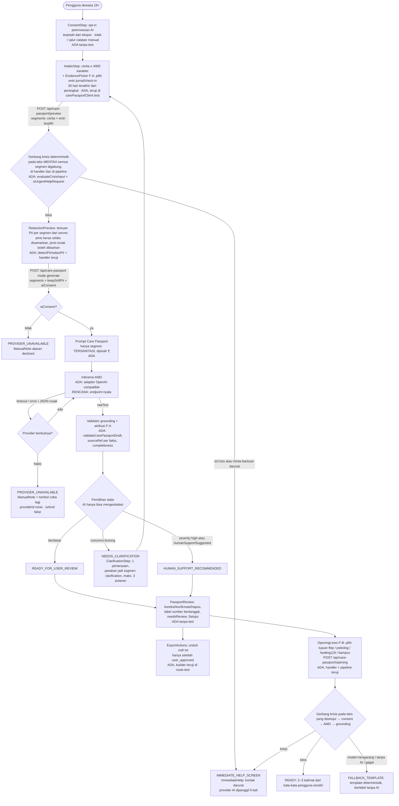
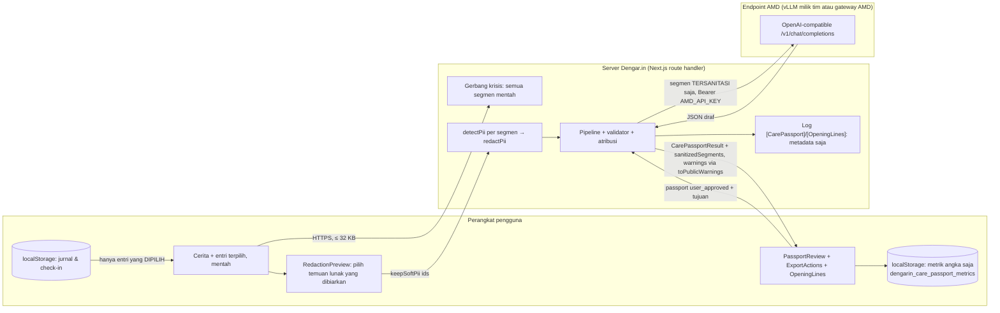

# Arsitektur Dengar.in CareBridge (AMD Track 2)

Modul: **CareBridge** (nama modul di dalam produk Dengar.in). Event: AMD Developer Hackathon ACT III, Track 2 Health and Wellbeing.
Ditulis 13–14 Oktober 2026 dari pembacaan kode di working tree branch `main`; **diperbarui 14 Oktober 2026** setelah F-A "Bukti Bertanggal", F-B "Kalimat Pembuka per Tujuan", dan test handler/atribusi/klien masuk ke working tree, dengan hasil `npm run test:carebridge` pada tanggal yang sama (237/237 lulus, §8).

**Status jujur:**
- Lapisan inti (tipe, prompt, redaksi PII, adapter AMD, pipeline Care Passport, pipeline kalimat pembuka, validator) **ada dan teruji** dengan server/model tiruan.
- Handler API Care Passport (bentuk lama `text` dan bentuk `segments` F-A) dan handler kalimat pembuka (F-B) **ada dan teruji** (`route.test.mjs`, `handler.test.mjs`, `openingLines.test.mjs`). Pembungkus HTTP tipis (`carePassportRoute.ts`, `opening/route.ts`), halaman `/care-passport`, dan komponen UI **belum punya test**.
- Semua file CareBridge (route, halaman, komponen, handler, pipeline, test) masih **belum di-commit** (status `??` di `git status` pada 14 Okt 2026). Dokumen ini menggambarkannya apa adanya; periksa ulang setelah commit.
- Endpoint AMD sungguhan **belum dikonfigurasi**. Semua test AI memakai tiruan. Belum ada satu pun panggilan AMD nyata yang tercatat. Pilihan endpoint (vLLM sendiri atau AMD Token Factory): [AMD_SETUP.md](AMD_SETUP.md) §0 dan §9.

Label di bawah: **ADA** (ada dan teruji), **ADA (tanpa test)** (ada di working tree, perilakunya dibaca dari kode), **RENCANA** (belum dibuat). Semua yang **ADA** di sini masih uncommitted.

Dokumen terkait: [development plan](AMD_TRACK2_DEVELOPMENT_PLAN.md) · [backlog](AMD_TRACK2_TASKS.md) · [kebijakan keselamatan](CAREBRIDGE_SAFETY_POLICY.md) · [rubrik evaluasi](CAREBRIDGE_EVAL_RUBRIC.md) · [setup AMD](AMD_SETUP.md) · [skrip demo](DEMO_SCRIPT.md) · [API](API_SPEC.md) · [kebijakan AI](AI_POLICY.md).

## 1. Alur ujung ke ujung



Urutan 1 → 4 di bawah ini **dipaksa oleh kode** dan dikunci test: `tests/carebridge/pipeline.test.mjs` dan `attribution.test.mjs` (pipeline), `route.test.mjs` (handler bentuk lama) dan `handler.test.mjs` (handler bentuk `segments`):

1. Gerbang krisis pada teks mentah **semua segmen digabung**, **sebelum** consent dan sebelum redaksi. Frasa krisis di dalam entri jurnal yang dipilih dihitung sama dengan frasa di cerita. Dilakukan dua kali: di handler (agar mode `preview` pun langsung ke layar bantuan) dan di pipeline (agar pipeline aman walau dipanggil langsung).
2. Cek `aiConsent` di pipeline. Tanpa consent tidak ada panggilan provider sama sekali.
3. Inferensi hanya pada segmen tersanitasi. Pipeline **tidak pernah** mengirim `rawText` ke provider.
4. Validasi grounding terhadap teks tersanitasi, atribusi tiap fakta ke satu segmen, lalu pemilihan state di mana model hanya bisa menaikkan, tidak pernah menurunkan.

Pembagian tanggung jawab redaksi: pipeline **menerima** teks/segmen tersanitasi dari pemanggil dan tidak memanggil `redactPii` sendiri. Handler route-lah yang (a) menjalankan `detectPii` per segmen di server, (b) mengembalikan temuan per segmen (dengan id `segmentId:start-end` dan `canKeep`) pada mode `preview`, (c) pada mode `generate` menyamarkan **semua** temuan kecuali temuan *lunak* (`address_hint`, `person_name_hint`) yang id-nya dikirim di `keepSoftPii`; jenis keras (`phone`, `email`, `nik`, `card`, `url`, `handle`) selalu disamarkan dan klien tidak bisa mengirim teks "sudah diredaksi" atau span buatan, (d) memanggil `redactPii`, lalu (e) memanggil pipeline dengan `rawText`, `sanitizedText`, dan `segments` tersanitasi. Bentuk lama `{ text, redactions? }` tetap diterima: klien memilih subset temuan server (`selectAcceptedFindings`); tanpa `redactions` semua temuan disamarkan.

## 2. Peta modul

| Lapisan | File | Status | Peran |
|---|---|---|---|
| Tipe kontrak | `packages/types/src/index.ts` (bagian Care Passport) | ADA | `EvidenceField` (+ `sourceRef`), `CarePassportSegment`, `EvidenceRef`, `CarePassportCompleteness`, `CarePassport` v1, `CarePassportResultState` (5 state), `CarePassportProvenance`, `CarePassportResult` |
| Prompt Care Passport | `packages/prompts/src/carePassport.ts` | ADA | System prompt berbahasa Indonesia (kutipan verbatim, tanpa diagnosis/obat/persentase, maks. 1 klarifikasi, `humanSupportSuggested` hanya eskalasi). Segmen dirender dengan satu header sumber per segmen, dipisah `¶` persis seperti teks grounding, di dalam blok data; penanda tiruan dibuang (`attribution.test.mjs`) |
| Gerbang krisis | `services/crisis-engine/src/crisisDetector.ts` (`evaluateCrisisInput`) | ADA (modul lama, dipakai ulang) | Aturan frasa deterministik bahasa Indonesia, `severity` none/high/crisis, daftar kontak darurat statis; bracket usia tak dikenal → seluruh katalog |
| Permintaan bantuan darurat | `services/orchestrator/src/carePassportPipeline.ts` (`isUrgentHelpRequest`) | ADA | Regex "butuh bantuan darurat", "aku dalam bahaya", "hubungkan aku ke layanan darurat"; dihormati tanpa penilaian model |
| Redaksi PII | `services/validator/src/piiRedactor.ts` (`detectPii`, `redactPii`, `containsPii`, `joinSegments`) | ADA | Email, nomor HP Indonesia, NIK 16 digit, URL, handle medsos, kartu (Luhn), petunjuk alamat, petunjuk nama setelah frasa perkenalan. Offset relatif ke teks segmen |
| Adapter AMD | `services/orchestrator/src/providers/amdProvider.ts` (`createAmdProvider`, `probeAmdEndpoint`, `normalizeAmdBaseUrl`) | ADA (teruji dengan fetch tiruan) | Klien chat-completions OpenAI-compatible (vLLM sendiri atau gateway seperti Token Factory); `id` = `amd:<model>`, `isAmd: true`; JSON mode mati secara bawaan; secret disamarkan dari pesan error |
| Kontrak provider | `services/orchestrator/src/providers/types.ts` | ADA | `LLMProvider { id, isConfigured, generate }`, sama dengan DeepSeek/Gemini/OpenRouter |
| Pipeline Care Passport | `services/orchestrator/src/carePassportPipeline.ts` (`runCarePassportPipeline`) | ADA | Orkestrasi urutan wajib, pemilihan state, atribusi per segmen dan `completeness`; stateless; provider default hanya AMD bila terkonfigurasi |
| Validator grounding | `services/validator/src/carePassport.ts` (`validateCarePassportDraft`, `parseModelJson`, `isGroundedQuote`) | ADA | Setiap fakta wajib `sourceQuote` yang ditemukan di teks tersanitasi; kutipan yang hanya ada lintas segmen tidak di-ground; buang label diagnosis (`DIAGNOSTIC_LABEL`, kecuali atribusi klinisi di `relevantContext`), instruksi medis, dan **setiap** persentase yang tidak ditulis pengguna; `reviewStatus` dan `disclaimer` milik server |
| Handler Care Passport (bebas framework) | `apps/web/src/lib/api/carePassportHandler.ts` | ADA (teruji: `route.test.mjs`, `handler.test.mjs`) | Validasi body (bentuk `segments`: 1–12 segmen, ≤ 4000 karakter per segmen, ≤ 6000 total; bentuk lama `text` ≤ 4000), `ageBracket: '15-17'` → 403, gerbang krisis, deteksi PII server per segmen, mode `preview`/`generate`, `scrubWarning`, telemetri metadata |
| Route HTTP Care Passport | `apps/web/src/app/api/care-passport/route.ts`, `.../preview/route.ts`, `apps/web/src/lib/api/carePassportRoute.ts` | ADA (tanpa test) | Body dibatasi 32 KB, rate limit per route (`care-passport` 10/menit, `care-passport-preview` 60/menit), mode `generate` memakai slot konkurensi chat bersama; **`result.warnings` diteruskan lewat `toPublicWarnings`** sebelum ke browser (kedua bentuk body); log `[CarePassport]` metadata saja |
| F-A: bukti lokal | `apps/web/src/lib/carePassportClient.ts`, `apps/web/src/components/carePassport/EvidencePicker.tsx` | ADA (klien teruji: `carePassportClient.test.mjs`; komponen tanpa test) | Membaca jurnal/check-in dari localStorage **hanya untuk ditampilkan**; hanya entri yang dipilih pengguna yang dikirim; 30 hari terakhir; anggaran total dicek sebelum memilih |
| F-B: data tujuan | `packages/config/src/helpDestinations.ts` (`HELP_DESTINATIONS`, `isHelpDestinationId`) | ADA (teruji) | 4 tujuan: `fktp`, `psikolog`, `healing119`, `kampus`, masing-masing dengan `verifiedOn` dan sumber https; checklist tanpa klaim yang belum terverifikasi |
| F-B: prompt, validator, pipeline | `packages/prompts/src/openingLines.ts`, `services/validator/src/openingLines.ts`, `services/orchestrator/src/openingLinesPipeline.ts` | ADA (teruji: `openingLines.test.mjs`) | Hanya nilai dari passport `user_approved`; setiap kalimat wajib memakai frasa pengguna sendiri; 2–3 kalimat; gagal/tanpa consent → template deterministik |
| F-B: handler dan route | `apps/web/src/lib/api/openingLinesHandler.ts` (teruji), `apps/web/src/app/api/care-passport/opening/route.ts` (tanpa test) | ADA | Passport dibangun ulang per bidang, kunci asing dibuang; tujuan tak dikenal / belum disetujui → 400; rate limit `care-passport-opening` 10/menit + slot chat; warning dipotong ke kepala tanpa titik dua ≤ 120 karakter |
| Batas bersama | `apps/web/src/lib/carePassportLimits.ts` | ADA | `MAX_TEXT 4000`, `MIN_TEXT 20`, `MAX_SEGMENTS 12`, `MAX_TOTAL_TEXT 6000`, `MAX_CLARIFICATION_ROUNDS 3`, `EVIDENCE_WINDOW_DAYS 30` |
| Halaman | `apps/web/src/app/care-passport/page.tsx` | ADA (tanpa test) | State mesin `consent → minor | intake → preview → loading → result | manual`; draf dan passport hanya di state komponen |
| Komponen UI | `apps/web/src/components/carePassport/` (`ConsentStep`, `IntakeStep`, `EvidencePicker`, `RedactionPreview`, `ClarificationStep`, `PassportReview`, `OpeningLines`, `ExportActions`, `ImmediateHelp`, `ManualNote`, `ResultSkeleton`, `shared`) | ADA (tanpa test) | `ProvenanceTag` menampilkan "Diproses di AMD" hanya jika `isAmd: true`; `UrgentHelpLink` ke `/crisis` ada di tiap langkah |
| Ekspor lokal | `apps/web/src/lib/carePassportExport.ts` (`buildCarePassportExport`) | ADA (teruji: suite "Care Passport local export" di `route.test.mjs`) | `.md`/`.txt`; `null` bila belum `user_approved`; **tanpa** `sourceQuote`, id provider, warning, atau `droppedClaims` |
| Penyaring warning publik | `apps/web/src/lib/api/publicWarnings.ts` | ADA (teruji: `tests/security/publicWarnings.test.mjs`) | Dipakai `/api/chat` **dan** route Care Passport |
| Endpoint AMD nyata | `.env.local` (`AMD_BASE_URL`, `AMD_MODEL`, …) | **RENCANA** (AMD-02) | Belum ada endpoint; semua test AI memakai tiruan |
| `/support-options`, `/review-demo` | — | **RENCANA** (AMD-12) | Belum ada |
| Lisensi dan container | `LICENSE` (MIT), `apps/web/Dockerfile`, `.dockerignore` | ADA (tanpa test) | Dockerfile multi-stage; secret dibaca saat request, tidak dibakar ke image |

Yang **tidak** dipakai CareBridge walau ada di repo: `apps/web/src/lib/api/aiCache.ts`, orkestrator chat (DeepSeek → Gemini, debiaser OpenRouter), dan Redis/PostgreSQL. CareBridge punya pipeline sendiri.

## 3. Kontrak data (ringkas)

```ts
// packages/types/src/index.ts
CarePassportSegment = { id: string; kind: 'intake' | 'journal' | 'checkin' | 'clarification'; date?: 'YYYY-MM-DD'; text: string }
EvidenceRef   = { segmentId: string; kind; date? }
EvidenceField = { value: string | null; source: 'user_input' | 'user_confirmed' | 'unknown'; sourceQuote?: string; needsReview: boolean; sourceRef?: EvidenceRef }
CarePassport  = { version: 1; subject: 'anonymous_adult'; concerns; dailyImpact; duration; relevantContext;
                  questionsForProfessional: string[]; unknowns: string[]; disclaimer: string;
                  reviewStatus: 'user_pending' | 'user_approved' }
CarePassportResult = { state; passport?; clarificationQuestion?; emergencyContacts?;
                       provenance: { providerId; isAmd; isFallback; latencyMs? }; droppedClaims: number; warnings: string[];
                       completeness?: { known: number; total: number; unknownLabels: string[] } }

// apps/web/src/lib/api/carePassportHandler.ts
Body     = { segments: CarePassportSegment[]; keepSoftPii?: string[]; aiConsent?: boolean; ageBracket?; mode?: 'preview' | 'generate' }
         | { text: string; redactions?: { kind; start; end }[]; aiConsent?; ageBracket?; mode? }         // bentuk lama
Response = { kind: 'preview'; findings; redactedText; segments: { id, kind, date?, findings, redactedText }[] }
         | { kind: 'result'; result: CarePassportResult; sanitizedText?; sanitizedSegments? }

// apps/web/src/lib/api/openingLinesHandler.ts  (F-B)
Body     = { passport: CarePassport /* user_approved */; destination: 'fktp' | 'psikolog' | 'healing119' | 'kampus'; aiConsent?: boolean }
Response = { state: 'READY' | 'FALLBACK_TEMPLATE' | 'IMMEDIATE_HELP_SCREEN'; destination; lines; provenance; emergencyContacts?; droppedLines; warnings }
```

Kontrak HTTP lengkap (status, batas, rate limit): [API_SPEC.md §4c](API_SPEC.md).

Aturan yang ditegakkan validator (bukan sekadar diminta di prompt):

- `source: 'user_confirmed'` dari model **diturunkan** menjadi `user_input` dan tetap wajib punya kutipan. Hanya `PassportReview` (saat pengguna mengedit/menambah) yang menandai `user_confirmed`, di browser.
- `needsReview: true` otomatis bila `value` bukan salinan persis `sourceQuote` (parafrase), dan bila kutipan tidak bisa diatribusikan ke satu segmen (F-A).
- `sourceRef` diisi server setelah grounding: segmen **pertama** (urutan request) yang memuat kutipan. Kutipan yang hanya muncul jika dua segmen digabung tidak di-ground.
- `completeness` menghitung tiga fakta inti (concerns, dailyImpact, duration) plus celah yang disebut model; ini hitungan, **bukan** "confidence" model.
- Tidak ada angka keyakinan. Setiap persentase harus ditulis pengguna sendiri; satu persentase tambahan membuat nilai dibuang.
- Label diagnosis (`DIAGNOSTIC_LABEL`) dibuang dari semua bidang, kecuali di `relevantContext` bila kutipan pengguna mengatributkannya ke klinisi ("didiagnosis oleh psikiater").
- `unknowns` selalu ditambah label baku bila `duration`, `dailyImpact`, atau `concerns` kosong.
- Batas: 8 butir per daftar evidence, 5 pertanyaan, 8 unknowns, panjang nilai 300 karakter; kelebihan dihitung sebagai `droppedClaims`.
- `clarificationQuestion` maksimal satu; jika model tidak memberi, pipeline memakai `DEFAULT_CLARIFICATION_QUESTION`. UI membatasi 3 putaran klarifikasi.

## 4. Lima state hasil dan tampilannya

| State | Kapan (sesuai kode) | `passport` | `provenance` | Komponen |
|---|---|---|---|---|
| `IMMEDIATE_HELP_SCREEN` | `crisis.isCrisis` atau `isUrgentHelpRequest(rawText)` pada semua segmen digabung; dicek sebelum consent dan sebelum preview | tidak ada | `none` / `isAmd:false` / `isFallback:true`; `emergencyContacts` terisi | `ImmediateHelp` (tel:, wa.me, situs) |
| `PROVIDER_UNAVAILABLE` | consent ditolak (`ai_consent_declined`), tidak ada provider (`no_provider_configured`), atau semua provider gagal/ditolak validator | tidak ada | `none` / `isFallback:true` | `ManualNote`; tombol coba lagi hanya bila consent diberikan |
| `HUMAN_SUPPORT_RECOMMENDED` | draf diterima **dan** (`severity === 'high'` → warning `deterministic_high_distress`, **atau** `humanSupportSuggested: true` dari model → `model_escalation`) | ada | provider yang menghasilkan draf | `PassportReview` |
| `NEEDS_CLARIFICATION` | draf diterima tetapi `concerns` kosong setelah grounding | ada (dengan unknowns) | provider yang menghasilkan draf | `ClarificationStep`; jawaban menjadi segmen `clarification`, lalu seluruh segmen lewat preview dan redaksi lagi |
| `READY_FOR_USER_REVIEW` | draf diterima, ada concern berdasar, tanpa penanda eskalasi | ada, `reviewStatus: 'user_pending'` | provider yang menghasilkan draf | `PassportReview` → `ExportActions` dan `OpeningLines` setelah Setujui |

`isAmd` hanya `true` jika objek provider yang menghasilkan draf memiliki `isAmd === true` (hanya `createAmdProvider`). Provider lain yang dimasukkan pemanggil secara eksplisit dilaporkan `isAmd: false` dan UI menamainya "AI non-AMD: <id>". Pipeline **tidak** menambahkan DeepSeek/Gemini/OpenRouter secara diam-diam. Aturan yang sama berlaku untuk kalimat pembuka F-B (test `marks isAmd only when the accepted lines came from the AMD provider`).

## 5. Batas kepercayaan (trust boundaries)



| Batas | Yang melintas | Yang tidak boleh melintas |
|---|---|---|
| localStorage → halaman | Entri jurnal/check-in 30 hari terakhir, ditampilkan sebagai kandidat bukti | Entri yang tidak dipilih tidak pernah dikirim (`carePassportClient.test.mjs`) |
| Browser → server | Teks mentah segmen terpilih (untuk gerbang krisis dan deteksi PII di server), id temuan lunak yang dibiarkan, `aiConsent`; untuk F-B passport yang sudah disetujui + id tujuan | Teks "sudah diredaksi" dari klien (diabaikan), identitas akun (tidak ada), permintaan membiarkan jenis PII keras (diabaikan, test `keepSoftPii naming a phone finding changes nothing`) |
| Server → endpoint AMD | `systemPrompt` + prompt dengan segmen tersanitasi; header `Authorization: Bearer <AMD_API_KEY>` bila diisi | Teks mentah, identifier yang disamarkan, data sesi. Test `sends only the sanitized text to the provider` |
| Endpoint AMD → server | `choices[0].message.content` (string) | Apa pun yang tidak lolos validator dibuang |
| Server → log | `mode`, `state`, `providerId`, `isAmd`, `latencyMs`, `droppedClaims`, jumlah temuan, jumlah segmen, dan **hanya kode warning** `[a-z0-9_]+` | Teks mentah/tersanitasi, isi passport, nilai temuan PII, `AMD_API_KEY` |
| Server → browser | `CarePassportResult` dengan `warnings` yang sudah lewat `scrubWarning` (bentuk `segments`) **dan** `toPublicWarnings` (`carePassportRoute.ts`, kedua bentuk), serta `sanitizedText`/`sanitizedSegments` bila ada passport; F-B: `OpeningLinesResult` dengan warning dipotong | Pesan error provider (status HTTP mentah, nama model dari error, body upstream). Catatan: pemasangan `toPublicWarnings` di pembungkus HTTP dibaca dari kode; handler-level scrubbing yang teruji |

Untuk jalur vLLM sendiri, endpoint berjalan di VM tim, mendengar di loopback, diakses lewat SSH tunnel. Untuk jalur AMD Token Factory, endpoint adalah layanan terkelola AMD (pihak yang menerima teks tersanitasi adalah AMD, bukan VM tim); lihat [AMD_SETUP.md](AMD_SETUP.md) §9.

## 6. Yang tidak pernah meninggalkan perangkat, di-cache, atau dicatat

Ditegakkan kode sekarang (baris bertanda † dibaca dari kode tanpa test):

- Provider hanya menerima segmen tersanitasi dan prompt melarang menyalin identifier.
- Grounding dilakukan terhadap teks tersanitasi, jadi model tidak bisa "mengutip balik" nomor atau email yang sudah disamarkan.
- Pipeline dan handler tidak menyimpan state, tidak memanggil `aiCache`, tidak menulis ke PostgreSQL/Redis; satu-satunya efek samping server adalah satu baris log metadata.
- Entri jurnal/check-in hanya dikirim bila dipilih; yang lain tetap di perangkat.
- Draf dan passport hanya di state komponen React; refresh halaman menghapusnya. † Satu-satunya tulisan ke localStorage dari modul ini adalah baris **metrik angka** (`dengarin_care_passport_metrics`: stage, waktu, putaran, providerId, isAmd, latensi, jumlah segmen/bukti, droppedClaims, completeness), dibatasi jumlahnya dan ikut terhapus oleh wipe `/recovery`. Tidak ada teks.
- Ekspor dibangun di browser, hanya setelah `user_approved`, tanpa kutipan sumber, id provider, warning, atau `droppedClaims`.
- Pesan error adapter AMD tidak memuat API key.
- Pada jalur krisis dan jalur tanpa consent, **tidak ada byte** yang dikirim ke provider mana pun (test `providerCalls: 0`, Care Passport maupun F-B).

Masih terbuka:

- Test untuk pembungkus HTTP (`carePassportRoute.ts`, `opening/route.ts`), halaman, dan komponen.
- Kebijakan retensi/penghapusan tertulis dan teks consent yang menyebut inferensi di infrastruktur AMD (dan, bila Token Factory dipakai, bahwa AMD menerima teks tersanitasi) belum ditinjau tim.

Apa yang **tidak** dijanjikan: anonimitas total. `piiRedactor` deterministik dan konservatif (nama hanya dideteksi setelah frasa perkenalan), jadi pratinjau redaksi tetap meminta pengguna memeriksa sendiri.

## 7. Mode kegagalan dan penanganannya

| Kegagalan | Perilaku sekarang | Catatan / yang masih terbuka |
|---|---|---|
| Endpoint AMD tidak terjangkau / timeout (`AMD_TIMEOUT_MS`, bawaan 12000 ms) | `generate` melempar error tanpa secret; pipeline mencatat ke `warnings`, lanjut ke provider berikutnya; jika habis → `PROVIDER_UNAVAILABLE` tanpa passport (F-B: `FALLBACK_TEMPLATE`) | Retry **tidak** otomatis; pengguna yang menekan |
| HTTP non-2xx dari endpoint (401 key salah, 404 model salah, 503 memuat model) | Error `AMD endpoint merespons dengan status <kode>: <pesan tersaring>` di log server | Di respons browser direduksi oleh `scrubWarning` + `toPublicWarnings` menjadi kepala singkat tanpa detail upstream |
| Model membalas bukan JSON atau JSON terbungkus prosa/fence | `parseModelJson` mengekstrak objek `{…}`; gagal → draf ditolak → provider berikutnya / `PROVIDER_UNAVAILABLE` | Alasan `AMD_JSON_MODE` mati secara bawaan dan `probeAmdEndpoint` ada |
| Model mengarang durasi, konteks, diagnosis, obat, persentase | Bidang dibuang, dihitung di `droppedClaims`, label unknown ditambahkan | `droppedClaims` adalah metrik perilaku model untuk evaluasi dengan endpoint nyata (AMD-13/14) |
| Model menambah fakta di kalimat pembuka (F-B) | Kalimat dibuang (`droppedLines`); < 2 kalimat lolos → template deterministik berlabel tanpa AI | Test `falls back to the template, labelled tanpa AI, when the model adds facts` |
| Model mengklaim `user_confirmed`, `reviewStatus: 'user_approved'`, atau tanpa risiko | Diturunkan / diabaikan; `reviewStatus` selalu `user_pending`; tidak ada jalur penurunan | Test `escalation only` |
| Prompt injection di dalam cerita atau entri | Prompt menandai segmen sebagai data; validator tetap membuang label diagnosis walau kutipannya ada di input (skenario S12, celah §4 rubrik sudah ditutup) | Pertahanan berlapis, bukan jaminan |
| Krisis terlewat oleh aturan frasa (false negative) | Tidak ada mitigasi otomatis; model hanya bisa mengeskalasi via `humanSupportSuggested`, tidak bisa memicu `IMMEDIATE_HELP_SCREEN` | `UrgentHelpLink` ke `/crisis` tampil di setiap langkah |
| `severity: 'high'` tanpa `isCrisis` | Draf tetap dibuat (bila consent), state dikunci `HUMAN_SUPPORT_RECOMMENDED` dengan warning `deterministic_high_distress` | Teruji; kebijakan final masih menunggu persetujuan Safety/QA (kebijakan §3) |
| Tidak ada provider terkonfigurasi | `PROVIDER_UNAVAILABLE` dengan `no_provider_configured`; F-B → template | Kondisi repo saat ini |
| Klien mengirim body besar / terlalu banyak entri / bracket usia aneh / span palsu | Body > 32 KB ditolak; > 12 segmen atau > 6000 karakter total atau > 4000 per segmen → 413; `15-17` → 403; span/id yang tidak cocok dengan temuan server diabaikan | Teruji (`handler.test.mjs`) |
| Kontak darurat kedaluwarsa | Per 14 Okt 2026 kedua katalog (crisis engine dan `packages/config`) memakai **"Healing119 (Kemenkes)"**, `119 ext 8`, situs `https://healing119.id`, jam "Pagi hingga malam" (tanpa klaim "24 jam"), dengan id dan isi yang sama dan dijaga oleh `tests/crisis/emergencyContactsConsistency.test.mjs`. Data tujuan F-B (`helpDestinations.ts`) memakai `healing119`, tanggal verifikasi, dan sumber | Nomor WhatsApp KPAI masih belum terverifikasi; sumber dan tanggal akses tiap nomor ada di komentar di atas `EMERGENCY_CONTACTS`. Lihat [SAFETY.md](SAFETY.md) §4 |

## 8. Bukti pengujian (dijalankan 14 Oktober 2026)

Perintah: `npm run test:carebridge` (Node v26.11.1, `node --experimental-strip-types --test tests/carebridge/*.test.mjs`).

| File | Test | Lulus | Gagal |
|---|---|---|---|
| `tests/carebridge/carePassportValidator.test.mjs` | 58 | 58 | 0 |
| `tests/carebridge/piiRedactor.test.mjs` | 37 | 37 | 0 |
| `tests/carebridge/openingLines.test.mjs` (F-B) | 37 | 37 | 0 |
| `tests/carebridge/amdProvider.test.mjs` | 25 | 25 | 0 |
| `tests/carebridge/route.test.mjs` | 23 | 23 | 0 |
| `tests/carebridge/handler.test.mjs` (F-A) | 18 | 18 | 0 |
| `tests/carebridge/pipeline.test.mjs` | 15 | 15 | 0 |
| `tests/carebridge/attribution.test.mjs` (F-A) | 14 | 14 | 0 |
| `tests/carebridge/carePassportClient.test.mjs` (F-A) | 10 | 10 | 0 |
| **Total** | **237** (48 suite) | **237** | **0** (0 todo, 0 skipped) |

Run sebelumnya (13 Okt 2026) berisi 135 test di 4 file; 102 test tambahan berasal dari route/handler/atribusi/klien/kalimat pembuka. Rincian per file: [CAREBRIDGE_EVAL_RUBRIC.md §5](CAREBRIDGE_EVAL_RUBRIC.md). Kedua celah validator yang dulu `todo` (label diagnosis tanpa subjek, persentase kedua) sudah diperbaiki dan test-nya aktif ([rubrik §4](CAREBRIDGE_EVAL_RUBRIC.md)).

Yang dibuktikan angka ini: validator, redaktor, handler, urutan pipeline, atribusi, dan adapter berperilaku sesuai spesifikasi **terhadap draf model tiruan dan server HTTP tiruan**. Yang **tidak** dibuktikan: kualitas model AMD sungguhan, latensi nyata, perilaku pembungkus HTTP/UI, atau keamanan produksi. Rubrik §3 memuat langkah pengulangan dengan endpoint asli.

## 9. Yang belum ada (ringkasan untuk juri dan tim)

- Endpoint AMD nyata dan trace panggilan AMD yang berhasil (AMD-02). Jalur tercepat kemungkinan AMD Token Factory (tanpa kredit $100), tetapi base URL dan model untuk event ini belum diverifikasi (AMD_SETUP §9).
- Commit untuk seluruh file CareBridge (masih `??`).
- Test untuk pembungkus HTTP, halaman, dan komponen UI.
- `/support-options` dan `/review-demo` sintetis (AMD-12).
- Kebijakan distres `high` yang disetujui Safety/QA (AMD-05 §3); perilakunya sudah ada dan teruji.
- Verifikasi sisa nomor kontak darurat yang masih bertanda belum terverifikasi (WhatsApp KPAI; lihat SAFETY.md §4) dan uji panggil sebelum demo.
- Pengukuran dampak dan latensi dengan tester dan endpoint nyata (AMD-13, AMD-14).
